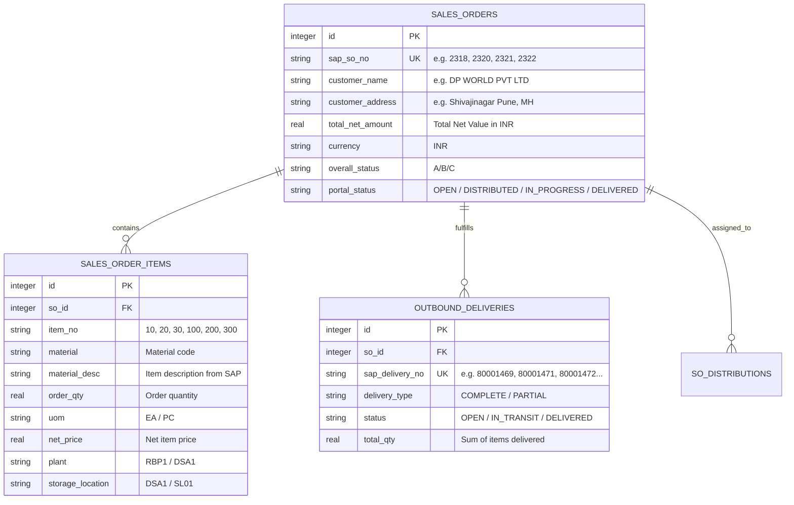

# Architecture & Execution Plan: Real SAP S/4HANA Sales Orders & Deliveries Integration

## Executive Summary & Design Thinking Context
As a senior SAP S/4HANA & Full-Stack Architect (20+ years enterprise experience), integrating SD (Sales & Distribution) and LE-SHP (Logistics Execution - Shipping) into an agile logistics execution portal requires mapping SAP business objects (`VBAK`/`VBAP` Sales Documents and `LIKP`/`LIPS` Outbound Deliveries) accurately while maintaining an intuitive, modern user experience for Company Administrators.

---

## 1. Audit: Real SAP System Findings & Screenshots Reconciliation

### A. SAP System Credentials & Connection
- **SAP Host:** `http://192.168.1.55:8000`
- **SAP Client:** `200`
- **Auth:** Basic Auth (`INT_VARAD` / `Password@123`)
- **OData Gateway:** `/sap/opu/odata/sap/API_SALES_ORDER_SRV` (Standard SAP S/4HANA API)

### B. Real Master & Transactional Data in SAP S21 System
From real SAP GUI screens (**VA03**, **VL03N**) and live OData probe:

| Case | SAP SO # | Sold-To Party / Customer Name & Address | Net Value | Line Items in SAP (VA03) | Real Deliveries (VL03N) | Delivery Nature |
|---|---|---|---|---|---|---|
| **Case 1** | **2318** | `131` – Industrial Mining Customer | 99.99 INR | **Item 10:** Material `33` ("Brake Pad"), Qty `1.000 EA` | `80001469` | Complete Delivery |
| **Case 2** | **2321** | `122` – DP WORLD PVT LTD, 123 Shivajinagar Pune, MH, 414305 | 268,013.20 INR | **Item 100:** `99` ("chair 01"), Qty `10 PC` **Item 200:** `33` ("Drilling machine spare part"), Qty `10 EA` **Item 300:** `41` ("Battery1"), Qty `10 EA` | `80001471` `80001472` | Multiple Material, Partial Delivery |
| **Case 3** | **2320** | `90000501` – Company Atharv Pharma abc, 6 Pune, MH, 987789 | 61,000.00 INR | **Item 10:** `1702` ("pharma product 01"), Qty `10 EA` **Item 20:** `1727` ("pharma product 10"), Qty `10 EA` **Item 30:** `1728` ("pharma product 09"), Qty `10 EA` | `80001470` `80001473` | Multiple Line Item, Partial Delivery |
| **Case 4** | **2322** | `90000501` – Company Atharv Pharma abc, 6 Pune, MH, 987789 | 26,000.00 INR | **Item 10:** `1702` ("pharma product 01"), Qty `5 EA` **Item 20:** `1727` ("pharma product 10"), Qty `5 EA` **Item 30:** `1728` ("pharma product 09"), Qty `5 EA` | `80001474` | Multiple Line Item, Complete Delivery |

---

## 2. Architecture & Data Model Overhaul

### A. Database Model Enhancements
To properly represent the relationship between a **Sales Order** and its **Outbound Deliveries** (VL03N) and line items:

---

## 3. Design Thinking: UI / UX Specifications for Inspection Desk

When the Company Admin clicks **`#SO`** or **`Inspect`**, the modal will render an enterprise-grade SAP Document Inspector structured into two clear areas:

1. **Header & Delivery Badges (VL03N Outbound Deliveries)**:
   - Displays Outbound Delivery document numbers with clear visual badges:
     - `Delivery #80001469` (Complete Delivery)
     - `Delivery #80001471` & `Delivery #80001472` (Partial Deliveries)
     - `Delivery #80001470` & `Delivery #80001473` (Partial Deliveries)
     - `Delivery #80001474` (Complete Delivery)
   - Displays real Customer info: **DP WORLD PVT LTD** (Pune), **Company Atharv Pharma abc** (Pune), etc.
   - Displays Net Value in INR (`268,013.20 INR`, `26,000.00 INR`).

2. **Line Items Breakdown Table (VA03 Sales Document)**:
   - Displays real SAP items: Material code, Description ("chair 01", "Drilling machine spare part", "Battery1", "pharma product 01/10/09", "Brake Pad").
   - Quantities with exact SAP UoM (`EA`, `PC`).
   - Plant (`RBP1`, `DSA1`) and Storage Location (`DSA1`, `SL01`).
   - Single-click action: **"Distribute This Order"** to assign as a complete unit.

---

## 4. Implementation Steps

1. **Database Schema & Seed**:
   - Add table `outbound_deliveries` to `schema_v3.sql` and `database_v3.ts`.
   - Seed authentic customer names, addresses, and delivery numbers matching the screenshots.
2. **Backend API**:
   - Update `SalesOrderAdapter.ts` to map real SAP live data and attach outbound deliveries.
   - Update `/api/v3/sales-orders` and `/api/v3/sales-orders/:id` to include deliveries list and currency amount.
3. **Frontend Inspector UI**:
   - Upgrade the Inspect modal in `AdminDashboard.tsx` to showcase real SAP delivery numbers, customer information, net order value in INR, and authentic line items.
4. **Build & Commit**:
   - Verify build passes cleanly and commit changes.
